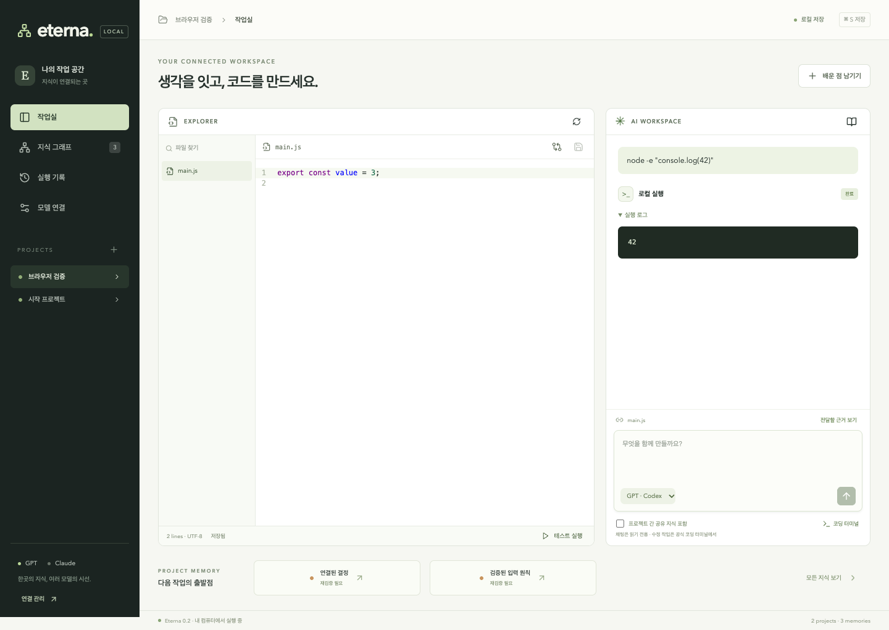
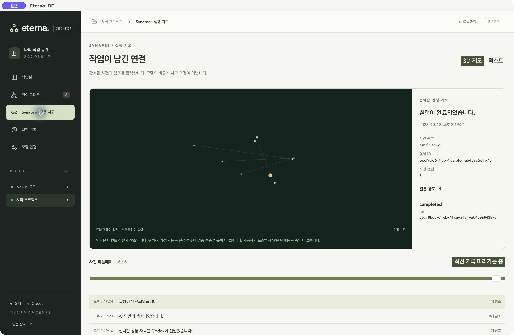

<div align="center">

# Eterna IDE

**Your models change. Your knowledge stays.**

A native Windows/macOS AI workspace that connects code, decisions, evidence, and official coding-agent terminals.

[](https://github.com/EternaxCode/eterna-ide/actions/workflows/ci.yml)
[](LICENSE)

[한국어 사용 설명서](docs/README.ko.md) · [Performance](docs/performance/README.md) · [Contributing](CONTRIBUTING.md)

</div>



## What it does

- **Edit and review:** syntax highlighting, local files, optimistic saves, and diff review.
- **Share knowledge across models:** one evidence-backed knowledge store for GPT/Codex and Claude Code; explicit opt-in for cross-project context.
- **Keep memory current:** records reference source hashes; changed evidence becomes stale. Revoked or outdated knowledge is excluded from inherited answers too.
- **Work in source snapshots:** coding terminals edit a separate source copy. Review and apply individual files without silently overwriting concurrent original edits.
- **Keep an execution trail:** local tests, exit codes, context snapshots, interruption status, and persistent history.
- **Use official authentication:** bundled official Codex CLI with ChatGPT login, and installed official Claude Code in an integrated terminal. No extracted OAuth tokens or silent API-key fallback.

## Install the desktop app

Download the macOS Apple Silicon DMG or Windows x64 installer from [GitHub Releases](https://github.com/EternaxCode/eterna-ide/releases). Desktop builds use Tauri 2 and Rust; **Node.js and a localhost server are not required to run the app**. Official AI CLIs and your project's development tools are separate installations.

The 0.3 beta is not Apple Developer ID notarized or commercially Windows-signed. macOS is tested on a real Mac; Windows validation uses installation and native renderer smoke tests in CI. Intel Mac and Windows ARM packages are not currently offered.

1. Select a project using the native folder picker.
2. Import existing `.data/nexus.sqlite` from **모델 연결 → 기존 데이터 가져오기**. The original stays untouched.
3. Open a file, inspect the context preview, and ask GPT a question.
4. Use the official coding terminal in a source snapshot, then review changes before applying them.
5. Open **Synapse · 실행 지도** to explore actual execution events and their Korean descriptions.

The interface is currently Korean. [Desktop guide](docs/DESKTOP.md) · [Legacy web guide](docs/README.ko.md).

For source development:

```sh
git clone https://github.com/EternaxCode/eterna-ide.git
cd eterna-ide
npm ci
npm run desktop:dev
```

Native development additionally requires the [Tauri platform prerequisites](https://v2.tauri.app/start/prerequisites/). The original web application remains available with `npm run launch`.

## Connect your subscription

**GPT / Codex:** use **모델 연결** (model connections) to start the official login. Existing ChatGPT authentication is recognized. The desktop app reuses an installed official native CLI and does not copy credentials. An empty model setting uses the CLI default; availability depends on your account. The legacy web runner includes its own official CLI package.

**Claude Code:** install the [official CLI](https://code.claude.com/docs/en/overview), then use the account-login terminal. Claude runs interactively with its own permission prompts. It reads the same context bundle as GPT, but its terminal output is not automatically ingested into memory; save selected conclusions explicitly.

Subscription limits and billing settings belong to the providers. Eterna does **not** rotate accounts to bypass limits, copy authentication tokens, or silently fall back to paid API calls. Real Claude inference requires your completed login and was not part of the original author's live verification.

## Performance, measured (web baseline)

The performance work targets local UI and data handling, not the model's inference speed. The reproducible fixture uses 500 knowledge records and 400 runs with 100KB contexts each. See the [report and raw results](docs/performance/README.md) for before/after measurements and limitations.

Heavy editor, language, graph, and terminal modules load on demand. Run summaries are stored separately from full contexts, unchanged state requests return no response body, and hidden tabs stop polling. CI enforces a 110KB gzip budget for the initial JavaScript entry.

## Data and boundaries

Desktop state lives in the OS app-data folder shown in the app. Legacy web state lives in `.data/`. The legacy database filename `nexus.sqlite`, storage keys, and `NEXUS_*` environment variables remain compatible with the initial prototype. Back up the database using a SQLite-aware backup or stop the server before copying the whole data directory. Do not commit or share this directory or launch URLs.

Snapshots support text source files up to 512KB each, fewer than 2,000 files, and 20MB total. Dependencies, secrets, symlinks, and binary assets are excluded. A source snapshot is **not an OS security sandbox**. Official CLI permissions still apply; user-triggered test commands run on the host with the user's privileges.

This is a single-user local application, not a network-exposed multi-tenant service. Graph links are navigational; vector search and automatic call-graph extraction are not implemented. Model switching shares explicit context, not hidden model reasoning or weights.

## Development

```sh
npm test
npm run check
npm run build
node scripts/check-bundle.mjs
npx playwright install chrome
npm run test:e2e
npm run benchmark
```

`npm start` runs in the foreground. `npm run dev` rebuilds once and watches the Node server. `scripts/smoke.mjs` and `scripts/terminal-smoke.mjs` are opt-in live provider probes that consume your subscription allowance.

See [CONTRIBUTING.md](CONTRIBUTING.md), [SECURITY.md](SECURITY.md), and the [MIT license](LICENSE). Built by [EternaxCode](https://github.com/EternaxCode).



## Native memory and Synapse

A Tauri/Rust desktop build is available for macOS Apple Silicon and Windows x64. It runs without the local Node server, retains the same UI, adds read-only legacy import into a separate CAS/Zstd-backed store, source-snapshot archival/restoration, and an actual-event 3D Synapse timeline. See [Desktop installation and operation](docs/DESKTOP.md). Official AI tools remain separate installations. Package verification does not imply Apple notarization or Windows commercial signing.
